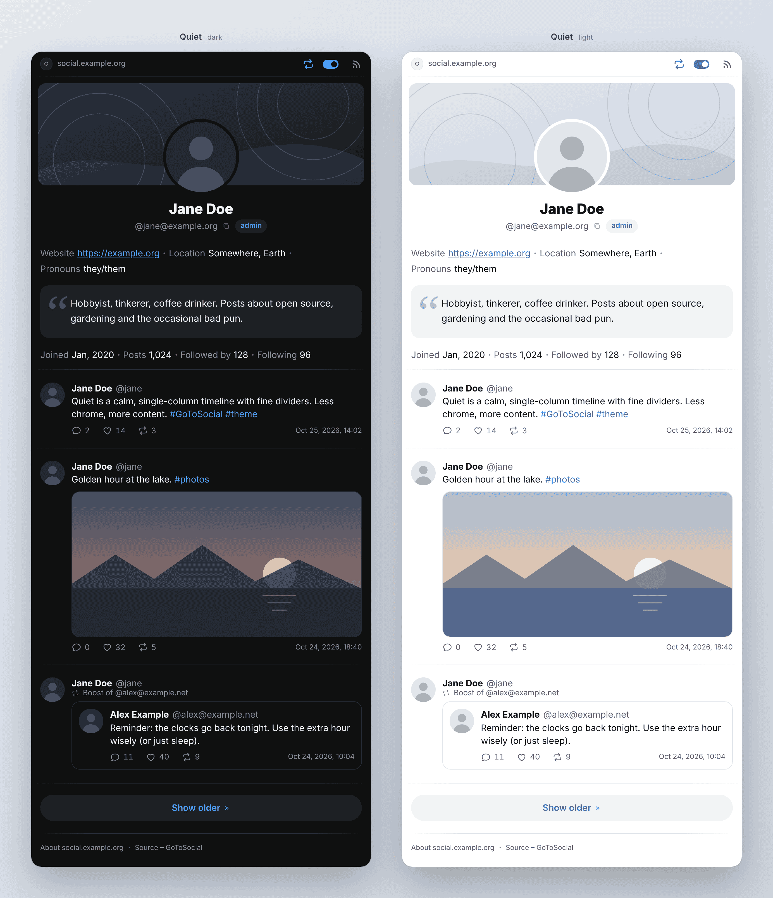

# Quiet

A calm, single-column timeline theme for [GoToSocial](https://gotosocial.org) with fine dividers. For quiet sloths. 🦥

## Preview

## Features

* Automatic light and dark mode, following your device settings
* Responsive layout
* Uses GoToSocial's built-in icon font

## Compatibility

Tested with [GoToSocial](https://codeberg.org/superseriousbusiness/gotosocial) **0.22.3**. Other versions may work, but changes to GoToSocial's HTML or CSS can affect the theme.

## Install

1. Copy the three `.css` files into `web/assets/themes/` of your GoToSocial installation. Keep them together: `quiet-auto.css` imports the other two.
2. Restart GoToSocial.
3. Choose the theme under **Settings → Profile → Theme**.
